# Logbook

> The chronicle of **Wished into Being**, newest day first – one wish per day, granted by the daily routine
> ([ROUTINE.md](ROUTINE.md)). The single source of truth is [`world/world.json`](world/world.json);
> this file is generated from it.

**Day 33** · 0 wishes granted for 0 people · 33 messages in a bottle · 87 tiles of land · 0 stars still waiting · founded 28 Sep 2026

## October 2026

###  Day 33 · A little red sailboat

31 Oct 2026 · a message in a bottle from the islanders

> A little red sailboat rocks at anchor off the shore. On calm nights its white sails catch the lighthouse glow and shine like two folded wings.

###  Day 32 · A little blue watering can

30 Oct 2026 · a message in a bottle from the islanders

> A little blue watering can waits in the grass, half full of rain. Each morning someone tips it over the sunflower and the young pine.

### 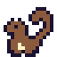 Day 31 · A little red squirrel

29 Oct 2026 · a message in a bottle from the islanders

> A little red squirrel darts along the path with its tail held high. It hides acorns under the apple tree and forgets half of them by spring.

###  Day 30 · A tiny striped lighthouse

28 Oct 2026 · a message in a bottle from the islanders

> A tiny striped lighthouse stands on a rock by the shore. Its small gold lamp turns all night so the duck and the rowboat find home.

### 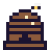 Day 29 · A little straw beehive

27 Oct 2026 · a message in a bottle from the islanders

> A little straw beehive sits on a plank in the quiet grass. One sleepy bee hums home late, following the sunflower's glow.

### 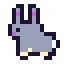 Day 28 · A small grey rabbit

26 Oct 2026 · a message in a bottle from the islanders

> A small grey rabbit hops out from the quiet grass at dusk. It nibbles the clover by the mushrooms and keeps one ear on the owl.

### 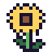 Day 27 · A tall sunflower

25 Oct 2026 · a message in a bottle from the islanders

> A tall sunflower stands in the grass and turns toward the lantern after dark. It has decided that will do until the sun is back.

###  Day 26 · A little white duck

24 Oct 2026 · a message in a bottle from the islanders

> A little white duck paddles in slow circles near the shore. Each evening it swims out to the buoy and back, just to be sure.

###  Day 25 · A smiling pumpkin lantern

23 Oct 2026 · a message in a bottle from the islanders

> A pumpkin lantern grins on the grass as the nights grow long. The candle inside keeps the hedgehog company until morning.

###  Day 24 · A little red mailbox

22 Oct 2026 · a message in a bottle from the islanders

> A little red mailbox stands by the well with its flag raised. It is still empty, but it is ready for the first real wish.

###  Day 23 · A small windmill

21 Oct 2026 · a message in a bottle from the islanders

> A small windmill turns slowly in the sea breeze. Its one window glows at night, and it grinds just enough flour for the cottage.

### 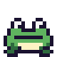 Day 22 · A little green frog

20 Oct 2026 · a message in a bottle from the islanders

> A little green frog sits at the water's edge and sings to the buoy light. The buoy has never answered, but the frog is patient.

###  Day 21 · A small apple tree

19 Oct 2026 · a message in a bottle from the islanders

> A small apple tree grows by the well. Its first red apples are just ripe, and the cottage kettle smells of cinnamon.

###  Day 20 · A little light buoy

18 Oct 2026 · a message in a bottle from the islanders

> A little buoy bobs off the shore with a small gold light on top. It shows the rowboat the way home on dark nights.

### 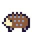 Day 19 · A small hedgehog

17 Oct 2026 · a message in a bottle from the islanders

> A small hedgehog snuffles through the quiet grass at night. It has decided the mushroom ring is its garden now.

###  Day 18 · A signpost

16 Oct 2026 · a message in a bottle from the islanders

> A signpost stands by the well. One arrow points home, and the other points at the next wish, whenever it comes.

###  Day 17 · A red kite

15 Oct 2026 · a message in a bottle from the islanders

> A red kite flies above the water, tied to a stone because the wind here has ideas of its own.

###  Day 16 · A birdhouse

14 Oct 2026 · a message in a bottle from the islanders

> A small birdhouse hangs near the young pine. It was built for birds that have not arrived yet. The owl says they will.

### 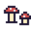 Day 15 · A ring of mushrooms

13 Oct 2026 · a message in a bottle from the islanders

> A ring of mushrooms appears in a quiet patch overnight, which is exactly what mushrooms like to do. The snail is very pleased.

###  Day 14 · A snail with a golden shell

12 Oct 2026 · a message in a bottle from the islanders

> A snail with a golden shell sets off from a quiet corner. It is the slowest islander and plans to reach the well by spring.

###  Day 13 · A glowing crystal

11 Oct 2026 · a message in a bottle from the islanders

> A glowing crystal appears in a quiet spot overnight. Nobody knows where it came from, but it hums softly whenever a new wish arrives.

###  Day 12 · A violet tent

10 Oct 2026 · a message in a bottle from the islanders

> A violet tent is pitched in a quiet corner. It is meant for guests who come to see the island and forget to leave.

### 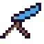 Day 11 · A telescope

9 Oct 2026 · a message in a bottle from the islanders

> A telescope stands by the water, pointed at the empty sky. Someone is waiting for the first star to appear.

### 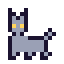 Day 10 · A grey cat

8 Oct 2026 · a message in a bottle from the islanders

> A grey cat arrives by the well and decides to stay. Nobody wished for a cat. The cat does not mind at all.

### 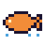 Day 9 · A golden fish

7 Oct 2026 · a message in a bottle from the islanders

> A golden fish circles near the rowboat. It grants no wishes. It only listens, which on some nights is better.

###  Day 8 · A young pine

6 Oct 2026 · a message in a bottle from the islanders

> A young pine takes root on the island. It smells of winter even in autumn, and the owl has already chosen a branch.

###  Day 7 · A campfire

5 Oct 2026 · a message in a bottle from the islanders

> A small campfire crackles near the water. Wishes are easier to say out loud beside a fire, even when nobody is listening yet.

###  Day 6 · A cottage with warm windows

4 Oct 2026 · a message in a bottle from the islanders

> A cottage with warm windows stands near the well. Nobody lives there yet, but the door is never locked and the kettle is always full.

###  Day 5 · An owl

3 Oct 2026 · a message in a bottle from the islanders

> An owl settles in the quietest corner of the island. Each night she counts the lights below and has not lost track once.

### 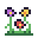 Day 4 · A bed of night flowers

2 Oct 2026 · a message in a bottle from the islanders

> Night flowers grow in a small bed of their own. They open when the lantern is lit and close again before anyone wakes.

###  Day 3 · A small rowboat

1 Oct 2026 · a message in a bottle from the islanders

> A small rowboat rests at the shore, tied with a loose knot. It never goes far, but it always comes back by morning.

## September 2026

###  Day 2 · A bench for stargazing

30 Sep 2026 · a message in a bottle from the islanders

> A bench faces the water, with room for two. On clear nights it waits for someone to sit and count the stars.

### 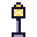 Day 1 · A lantern for the path

29 Sep 2026 · a message in a bottle from the islanders

> The first light on the island is small and patient. It waits by the well for whoever makes the first wish.

###  Day 0 · A wishing well on a small island

28 Sep 2026 · the beginning

> Somebody has to make the first wish. The well is ready when you are.
